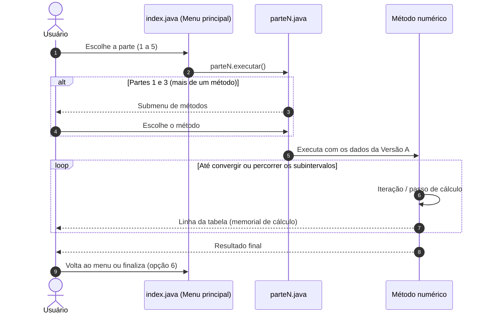
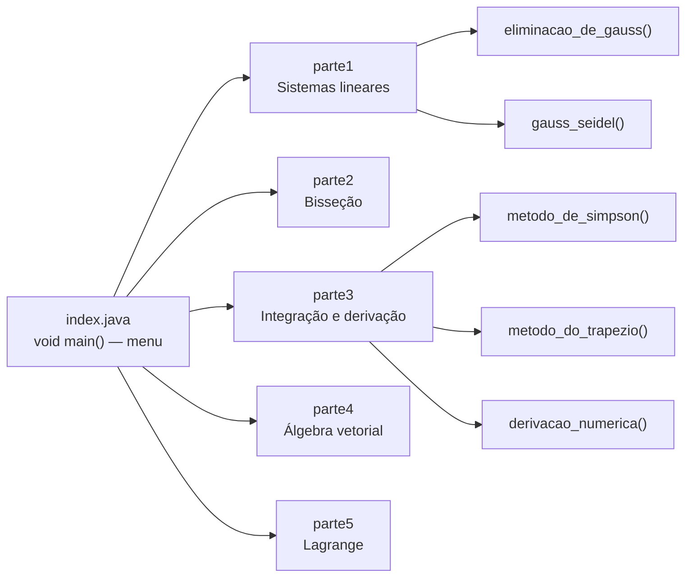
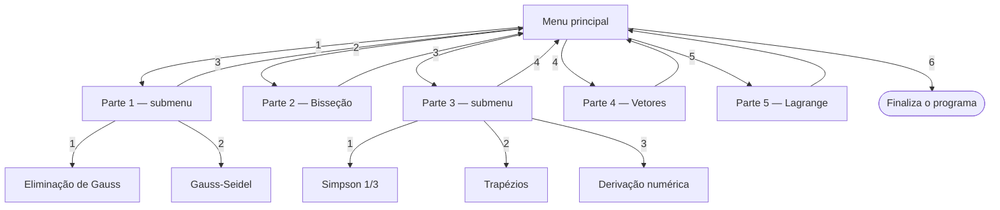

# 🌉 Applied Computational Mathematics — Dimensionamento de uma Passarela


> Métodos numéricos implementados do zero em Java para dimensionar uma passarela metálica de pedestres.

O **Applied Computational Mathematics** é um projeto acadêmico da disciplina **Matemática Computacional Aplicada**, do curso de **Ciência da Computação** da **Universidade Anhembi Morumbi**, desenvolvido para a avaliação A3. É uma aplicação de console em **Java 25**, sem bibliotecas externas, que resolve o **Projeto 1 — Dimensionamento de uma Passarela de Pedestres (Versão A)** do edital: forças internas da treliça, carga crítica de flambagem, força do vento, geometria espacial e deflexão da viga. Cada método é exibido passo a passo em tabelas no terminal, como memorial de cálculo.



---

## ✨ O Problema

O dimensionamento de uma passarela metálica sobre um canal de drenagem depende de cálculos que não têm solução prática à mão ou exigem verificação rigorosa:

- **Forças nas treliças** descritas por um sistema linear de equilíbrio de nós.
- **Instabilidade por flambagem** modelada por um polinômio cuja raiz define a carga crítica.
- **Força do vento** com pressão variável ao longo da altura, que precisa ser integrada.
- **Geometria espacial** das barras, para saber direções, ângulos de montagem e áreas das faces.
- **Deflexões** em pontos da viga onde não há sensores instalados.

## 🚀 A Solução

Um programa de console com um menu por parte do edital, que executa cada método numérico e imprime o passo a passo:

- **Sistemas lineares**: Eliminação de Gauss (exato) comparada ao Gauss-Seidel (iterativo, tolerância de $10^{-5}$).
- **Zeros de funções**: Método da Bisseção com precisão de $10^{-7}$.
- **Integração e derivação numérica**: Regra de Simpson 1/3, Regra dos Trapézios e Diferença Finita Centrada.
- **Álgebra vetorial**: vetores unitários, produto escalar e produto vetorial.
- **Interpolação polinomial**: Polinômio de Lagrange.

## 🎯 Diferenciais

- **Sem bibliotecas externas**: só `java.util.Scanner`, `java.util.Arrays` e `java.lang.Math`; todos os métodos foram implementados do zero.
- **Memorial de cálculo no terminal**: cada iteração ou subintervalo aparece em uma tabela formatada.
- **Comparação entre métodos**: as Partes 1 e 3 têm submenus para comparar o método exato com o iterativo e Simpson com Trapézios.
- **Java moderno**: arquivo-fonte compacto com `void main()` sem classe declarada, `java.lang.IO`, switch expressions e Streams API.

---

## 🛠️ Stack Tecnológica

| Camada | Tecnologia |
|---|---|
| **Linguagem** | Java 25 (arquivo-fonte compacto e `java.lang.IO`) |
| **Interface** | Console (menus numéricos lidos com `Scanner`) |
| **Bibliotecas** | Apenas a biblioteca padrão (`java.util`, `java.lang.Math`) |
| **Build** | `javac` / launcher de código-fonte do `java` (sem Maven ou Gradle) |
| **IDE** | IntelliJ IDEA (módulo `.iml` versionado; a pasta `.idea/` é ignorada pelo git) |

---

## 🏛️ Arquitetura

O programa é dividido em uma classe por parte do edital. O ponto de entrada (`index.java`) é um arquivo-fonte compacto: o `void main()` exibe o menu e delega para o método estático `executar()` da parte escolhida.



| Classe | Responsabilidade | Métodos |
| :--- | :--- | :--- |
| `index` | Menu principal e laço de execução | `main()` |
| `parte1` | Forças internas da treliça | `executar()`, `eliminacao_de_gauss()`, `gauss_seidel()` |
| `parte2` | Carga crítica de flambagem | `executar()`, `funcao(x)` |
| `parte3` | Força total do vento e taxa de variação | `executar()`, `metodo_de_simpson()`, `metodo_do_trapezio()`, `derivacao_numerica()`, `w(z)` |
| `parte4` | Geometria espacial dos nós | `executar()` |
| `parte5` | Deflexão da viga | `executar()` |

---

## 🧮 Funcionalidades & Métodos

| Parte | Problema | Método | Dados (Versão A) | Resultado |
| :---: | :--- | :--- | :--- | :--- |
| 1 | Forças internas da treliça | Eliminação de Gauss | Sistema 4×4 de equilíbrio de nós | $F_1 = 14{,}9673$, $F_2 = 9{,}8693$, $F_3 = 24{,}5098$, $F_4 = 8{,}1699$ |
| 1 | Forças internas da treliça | Gauss-Seidel (tolerância $10^{-5}$) | Mesmo sistema | Converge em 9 iterações para os mesmos valores |
| 2 | Carga crítica de flambagem | Bisseção (precisão $10^{-7}$) | $f(x) = x^3 - 5x^2 + 8x - 5$ em $[2, 4]$ | Raiz $x \approx 2{,}7548776$ em 25 iterações |
| 3 | Força total do vento | Simpson 1/3 ($h = 0{,}5$, 30 subintervalos) | $w(z) = 0{,}1z^3 - 1{,}5z^2 + 10z + 20$, $H = 15\,m$ | $F = 1003{,}125$ |
| 3 | Força total do vento | Trapézios ($h = 2{,}5$, 6 subintervalos) | Mesma função | $F \approx 1014{,}8438$ |
| 3 | Taxa de variação da pressão | Diferença Finita Centrada ($h = 0{,}5$) | Ponto médio $z = 7{,}5\,m$ | $dw/dz = 4{,}4$ |
| 4 | Geometria dos nós | Vetor unitário, produto escalar e vetorial | $A(0,0,0)$, $B(2,4,1)$, $C(4,0,2)$ | $\theta \approx 60{,}79°$, área $\approx 8{,}9443$ |
| 5 | Deflexão da viga | Interpolação de Lagrange | $x = \{0, 2, 4, 6\}$, $y = \{0; -1{,}2; -2{,}5; -1{,}8\}$ | $P(3) \approx -1{,}9687\,mm$ |

A fundamentação teórica, a justificativa de cada método e o memorial de cálculo completo estão no [relatório técnico](docs/report.md).

---

## 🖥️ Interface (Menus do Console)

A aplicação é operada pelo terminal, digitando o número da opção e pressionando Enter.



| Menu | Opções |
| :--- | :--- |
| **Principal** | `1` Primeira parte · `2` Segunda parte · `3` Terceira parte · `4` Quarta parte · `5` Quinta parte · `6` Finalizar o programa |
| **Parte 1** | `1` Eliminação de Gauss · `2` Gauss-Seidel · `3` Voltar para o início |
| **Parte 3** | `1` Método de Simpson 1/3 · `2` Método do trapézio · `3` Derivação Numérica · `4` Voltar para o início |

Exemplo de saída (Parte 2, últimas iterações):

```text
Iteração  a           m           b           f(a)        f(m)        f(b)        e
----------------------------------------------------------------------------------------------
24        2,7548776   2,7548777   2,7548778   -0,0000003  0,0000001   0,0000004   0,0000001
25        2,7548776   2,7548776   2,7548777   -0,0000003  -0,0000001  0,0000001   0,0000001

Raiz encontrada: 2,7548776 (após 25 iterações)
```

Os números usam o separador decimal da localidade do sistema (vírgula em pt-BR).

---

## 📁 Estrutura do Projeto

```text
applied-computational-mathematics/
├── A3 - Matematica Computacional.iml    # Módulo do IntelliJ IDEA
├── docs/
│   ├── notice.md                        # Edital da A3 (Projeto 1, Versão A)
│   └── report.md                        # Relatório técnico entregue
├── src/
│   ├── index.java                       # Ponto de entrada: menu principal
│   ├── parte1.java                      # Sistemas lineares (Gauss + Gauss-Seidel)
│   ├── parte2.java                      # Raízes (Bisseção)
│   ├── parte3.java                      # Integração (Simpson + Trapézios) e derivação
│   ├── parte4.java                      # Álgebra vetorial
│   └── parte5.java                      # Interpolação (Lagrange)
├── LICENSE
└── README.md
```

---

## ⚡ Quick Start

### Pré-requisitos
- [JDK 25](https://jdk.java.net/25/) ou superior. O `index.java` usa arquivo-fonte compacto e a classe `java.lang.IO`, disponíveis a partir do Java 25.

### 1. Clonar o repositório
```bash
git clone https://github.com/matheusnascimentods/applied-computational-mathematics.git
cd applied-computational-mathematics
```

### 2. Executar

**Direto pelo código-fonte** (o launcher do Java compila as classes em memória):
```bash
java src/index.java
```

**Ou compilando antes:**
```bash
javac src/*.java -d out
java -cp out index
```

**No IntelliJ IDEA:** abra a pasta do projeto, confirme o JDK 25 em *Project Structure* e execute o `src/index.java`.

---

## 💻 Comandos Úteis

```bash
# Executar sem compilar antes
java src/index.java

# Compilar todas as classes para a pasta out/ (ignorada pelo git)
javac src/*.java -d out

# Executar a partir das classes compiladas
java -cp out index

# Conferir a versão do Java
java -version
```

---

## 📚 Documentação do Projeto

| Documento | Conteúdo |
|---|---|
| [`docs/notice.md`](docs/notice.md) | Edital da avaliação A3: objetivo, regras, entregáveis, enunciado do Projeto 1 (Versão A) e critérios de avaliação |
| [`docs/report.md`](docs/report.md) | Relatório técnico entregue: escolha dos métodos, memorial de cálculo e decisões de implementação em Java |

---

## 🎓 Contexto Acadêmico

Projeto desenvolvido em grupo para a avaliação **A3** da disciplina **Matemática Computacional Aplicada**, do curso de **Ciência da Computação** da **Universidade Anhembi Morumbi**. O edital pedia a resolução de um entre seis projetos de engenharia/tecnologia, em Versão A ou B, com implementação recomendada em Java, relatório técnico e apresentação em sala. O grupo resolveu o **Projeto 1 — Dimensionamento de uma Passarela de Pedestres (Versão A)**.

---

## 🔒 Boas Práticas & Limitações

- **Sem dependências**: todo o cálculo usa apenas a biblioteca padrão do Java, o que facilita a execução em qualquer máquina com o JDK 25.
- **Sem dados externos**: nenhum arquivo é lido ou gravado; tudo acontece em memória.

### Limitações conhecidas
- **Dados fixos no código**: os valores da Versão A estão escritos nas classes; não é possível informar outros dados pela interface.
- **Entrada sem validação**: digitar algo que não seja número no menu encerra o programa com `InputMismatchException`.
- **Entrada por pipe**: cada leitura cria um novo `Scanner`, então enviar várias opções de uma vez (ex.: `printf "1\n2\n" | java ...`) não funciona; o uso esperado é interativo.
- **Derivação numérica**: o programa calcula só a diferença centrada; as diferenças progressiva e regressiva aparecem apenas no relatório.
- **Convenções de nome**: as classes usam nomes em minúsculas (`parte1`, `index`) em vez do padrão `PascalCase` do Java.
- **Sem testes automatizados**: os resultados foram conferidos com o memorial de cálculo do relatório.

---

## 🤝 Contribuindo

1. Faça um Fork do projeto
2. Crie uma branch para a sua funcionalidade (`git checkout -b feature/nome-da-feature`)
3. Faça o commit das suas alterações (`git commit -m 'feat: implementa nova funcionalidade'`)
4. Envie para o repositório remoto (`git push origin feature/nome-da-feature`)
5. Abra um **Pull Request** detalhando as alterações

---

## 📄 Licença

Distribuído sob a licença MIT. Veja [`LICENSE`](LICENSE) para mais detalhes.

---
Feito com ❤️ por [@matheusnascimentods](https://github.com/matheusnascimentods)
